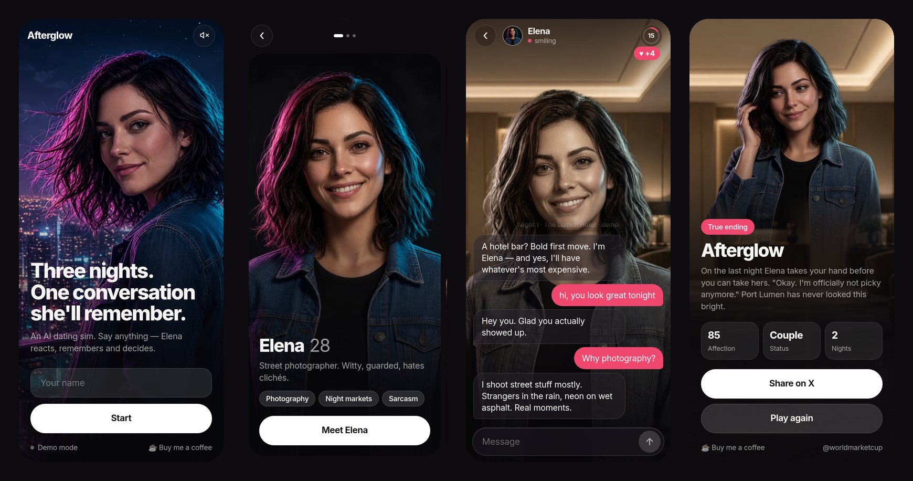

# AFTERGLOW — an AI dating sim

**▶ Play: https://andremka030.github.io/afterglow/**



Three nights in Port Lumen. You talk to Elena in your own words. An LLM (xAI Grok) plays her, she remembers past dates,
and her mood and affection react to what you say. Four locations (Lumen Hotel, Skyline Rooftop, Coral Bay, Lantern Market),
a phone between dates, and 3 endings. It's a static site for GitHub Pages and needs no build step. The AI runs through a small
Cloudflare Worker, so no key ever reaches the browser. Without the proxy, the game falls back to a scripted demo mode.

Built mobile-first, like an app: full-screen portrait art, chat bubbles over Elena, swipe cards, bottom sheets.
**Install it:** open the link on your phone → Share → *Add to Home Screen* (iOS) or *Install app* (Android/Chrome). It runs full-screen and works offline in demo mode.

Made by [@worldmarketcup](https://x.com/worldmarketcup) · ☕ [Buy me a coffee](https://buymeacoffee.com/citadelxcom)

## Play locally
```bash
node dev/server.mjs                         # offline demo mode (scripted Elena), http://localhost:8080
LLM_API_KEY=xai-... node dev/server.mjs     # live AI through the local proxy (key read from env only)
# optional: LLM_BASE_URL=https://api.openai.com/v1 LLM_MODEL=gpt-4o-mini PORT=8080
```
The badge on the title screen shows **● Live AI** or **Demo mode**.

## Publish
1. Deploy the proxy: see `worker/README.md` (Cloudflare Worker; the key is stored as a secret).
2. Put the Worker URL and your Buy Me a Coffee link in `js/config.js`.
3. Push the folder to a GitHub repo and turn on Pages. `worker/`, `dev/` and `api/` hold no secrets, so they are safe to commit.

## How it works
- `manifest.webmanifest`, `sw.js`: PWA — installable, standalone, caches the app shell and art (never the AI API).
- `index.html`, `style.css`, `js/game.js`: screens (title → characters → location → date chat → phone → ending), the affection meter (5 levels), the daily message limit, save in localStorage.
- `js/fallback.js`: offline Elena with keyword replies. It's used when no API is set or the API fails.
- `api/core.mjs`: the prompt and JSON parsing, shared by the Worker and the dev server. The model returns `{reply, emotion, affection_delta}`.
- `worker/`: the Cloudflare proxy (CORS allow-list, per-IP rate limit, size limits).
- `tools/xai_image.py`: generates or edits art with the xAI Imagine API (key from env).
- `tools/mobile-assets.py`: 9:16 portrait crops for phones and PWA icons.
- `tools/import-assets.py`: turns `art-src/` into web-sized webp files in `assets/img/`, cutting Elena out of her backdrop with rembg.

Content rules: all characters are fictional adults. Romance is PG-13, and Elena deflects sexual requests in character.


## Credits
Game, writing and art direction: [@worldmarketcup](https://x.com/worldmarketcup). Art generated with xAI Imagine; font Inter (SIL OFL).
